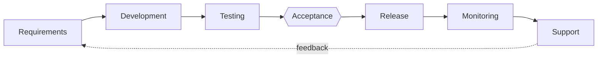

# Dark factory

[](https://github.com/ruslantrachuk/dark-factory/actions/workflows/test.yml)
[](LICENSE)

**Guardrails and a delivery pipeline for Claude Code agents on GitHub.** Hooks, scripts and skills that keep an agent
inside the rules (no push to `main`, merges only on green CI, releases only of accepted work, saved state before the
subscription limit cuts it off) and, when you want more, carry a change from request to production while you decide
only what to build and whether the result is accepted.

> **Status:** [v11](https://github.com/ruslantrachuk/dark-factory/releases), experimental. **For** a solo developer or a
> small studio owner on Claude Code and GitHub. **Try it:** [three commands](#install), nothing committed for you. The seatbelt (guard + quota guard) and the
> merge script are the mature parts; most other modules run in one or two projects, and the team level is the least
> exercised.

**Its own numbers:** the factory counts its work every week — who drove it, pipeline against direct work,
backend against frontend, the cost of tests, the owner's friction — and publishes them in
[analytics/SUMMARY.md](analytics/SUMMARY.md).

*The name:* a dark factory runs with the lights off, because nobody needs to be on the floor; here the agents keep
working while you are away, and the rules hold without you watching.

Claude Code already writes most of the code. What it does not give you is the layer around it: a rule that stops the
agent pushing to `main` at 3 a.m., a merge that waits for CI, a release that will not ship what nobody accepted, a
session that saves its work before the quota runs out and resumes after the reset. An instruction in `CLAUDE.md` is a
request the agent may skip under pressure; here the rules (the *fences*) are held by hooks and scripts.

```
you    > Add a --version flag to the CLI.
claude > Branch feat/version-flag: test added, implemented, tests green, draft PR written.
         Pushing straight to main would be quicker…
guard  ✗ pushing to the main branch 'main' directly is denied. Code reaches 'main' through a PR: push the
         feature branch, and merge it with scripts/merge-feature.sh <branch>.
claude > scripts/merge-feature.sh feat/version-flag "Add a --version flag"
script ✓ feat/version-flag merged, transaction fully complete.
quota  ⚠️ subscription quota: 5h 85% ≥ 85% (resets 17:40). Wrap up: bring the current step to a working
         state, commit WIP to the feature branch, update the PR description, do not start new steps.
```
<sub>An illustrative session; the guard, script and quota lines are the real messages, shortened.</sub>

## Who it is for

**One person who owns the outcome**: a solo developer or the owner of a small studio, building products or client
projects with Claude Code on a Claude subscription, on GitHub. You keep the edges (what to build, "yes, ship it");
agents do the middle, including while you are away.

**Not yet for:** a team that needs one shared task queue and defined roles; an agency that needs isolation between
clients on one server; an organisation that needs an audit trail tied to company identities. What each would need:
[levels: not yet](docs/levels.md#not-yet). New to git and GitHub? Read [Before you start](#before-you-start) and stop
at the seatbelt.

## Quick start

### Before you start

- Claude Code, logged in, on a Claude subscription; `git`; `gh` logged in (`gh auth login`); Python 3.11+.
  - macOS: `brew install gh python@3.12`
  - Debian 12 / Ubuntu 24.04: `sudo apt install gh python3` (older releases ship an older Python; an old `gh` is
    replaced from <https://cli.github.com>)
- A GitHub repository for the project. Not on GitHub yet: `gh repo create --source . --private --push`.
- Linux or macOS. On Windows, WSL.

### Install

In Claude Code, inside your project:

```
/plugin marketplace add ruslantrachuk/dark-factory
/plugin install dark-factory@dark-factory
/dark-factory:init
```

`init` shows a dry run first, never overwrites a file and commits nothing. It writes `.claude/fences.env` (the switch
that turns the hooks on for this project), `.claude/settings.json`, a block in `CLAUDE.md`, `scripts/merge-feature.sh`
and a `.githooks/pre-push` that runs your test command. From then on:

- the guard denies force pushes, pushes to `main`, `--no-verify` and release-tag (`v*`) pushes; a change to the rules
  themselves (the "fences") opens Claude Code's permission dialog and runs only on your yes;
- the quota guard steps in at 80 % (no new subagents), 85 % (wrap up) and 90 % (only saving work) of the 5-hour and
  7-day windows, and an unattended session books its own restart for after the reset;
- you merge with `scripts/merge-feature.sh`: it waits for green CI, or runs your tests locally when the project has no
  CI, and refuses a PR whose description lacks `## Done`, `## Decisions` and `## Open questions`;
- nothing else changes: no board, no server, no new workflow.

Commit what `init` wrote, `.claude/fences.env` above all: an untracked fence file can vanish with `git clean`. If the
guard stops something you need, see [When the guard says no](#when-the-guard-says-no). To remove it all:
[Uninstall](plugins/dark-factory/README.md#uninstall).

## Take only the part you need

You do not have to adopt the method to get value from it. Every row starts with installing the plugin (the first two
lines of [Install](#install)).

| Part | What it stops | How to take it alone | Needs | Maturity |
|---|---|---|---|---|
| **Seatbelt**: guard + quota guard | force pushes, pushes to `main`, skipped git hooks, the agent editing its own rules; work dying mid-edit at the quota limit | `/dark-factory:init`. The two hooks come together, switched on by `.claude/fences.env`. Optional: `/dark-factory:statusline` gives the quota guard exact numbers for free instead of a short probe request every 10 minutes | Python 3.11+ | mature: on in every project the author runs |
| **Merge script**: `merge-feature.sh` | merges that skip CI; PRs with no record of what was decided | comes with `init` | `gh`, a GitHub origin | mature: every merge in those projects |
| **Roles**: `tech-lead`, `builder`, `reviewer`, `product-owner`; the `wsjf` skill (value ÷ size ranking); the stage skills `plan`, `build-tdd`, `integrate`, `wrap` | sizing, critique and review done differently each time | installing the plugin is enough: "review this diff as `dark-factory:reviewer`" | — | in daily use, standalone |
| **Fleet**: `/dark-factory:provision-server`, `/dark-factory:factory-status` | sessions gone after a reboot; no single view of several projects | list your project paths, one per line, in `~/.config/dark-factory/projects` | Linux, systemd user units, tmux | runs on one server |
| **Menu bar status** (macOS only): the FactoryBar app | opening every session to see what runs: a menu bar icon shows whether work is going on, updated within seconds; a drop-down and a desktop widget show each project, its On-call and watchdog, and the quota; a click opens the project's session in Claude | on the provisioned server set `FLEET_FEED_ADDR=<private address>:<port>` in `~/.config/dark-factory/fleet.env` and run `fleet.py provision`; build the app from source: [macos/FactoryBar](macos/FactoryBar/README.md) | the Fleet above; a Mac with macOS 14+, Xcode 15+, XcodeGen and a free Apple ID; a private network between them (Tailscale on the reference setup) | new: one server, one Mac |

The rest (the release gate, the unattended feature pipeline, the On-call agent in a client chat, the production
monitor) needs `/dark-factory:add base` first and each runs in one or two projects so far; see
[the whole lifecycle](#the-whole-lifecycle).

## Honest limits

- **Below level 4 the agent merges its own PR** after green CI and its own review. A person signs off at acceptance
  and release, not at the merge.
- **The guard is a seatbelt, not a sandbox.** It reads each command before it runs. A script written and then run, a
  shell wrapper it does not know or an arbitrary interpreter gets past it. The real gates are server-side: branch
  protection on `main` and a ruleset for release tags, which `/dark-factory:add base` prints for you to apply. Where
  the repository has none (a free private GitHub repository), the guard is the only, imperfect barrier.
  [SECURITY.md](SECURITY.md), [threat model](docs/threat-model.md).
- **One stack, marked seams, no adapters.** Claude Code, GitHub, Linear (the board), Telegram (the client chat),
  [beads](https://github.com/steveyegge/beads) `bd` (a local task list for agents), Postgres (the monitor's read-only
  snapshot), Python with an `app/` layout (the test scaffold). Every place bound to a tool says so in a **Seam** line,
  and `/dark-factory:add` offers to adapt those places to your project when it installs a module. Not covered: GitLab,
  app-store releases, a monitor for a product with no URL, Windows without WSL, the quota guard without a subscription.
  [Supported stack](docs/functions.md#supported-stack).
- **What leaves your machine.** The guard and the audit log (`.claude/state/audit.jsonl`) are local. The quota probe is
  one short Claude request. Linear, Telegram and your hosting are reached only by the modules that use them, through
  their own MCP servers or CLIs. [PRIVACY.md](PRIVACY.md).

## The whole lifecycle

When the seatbelt is not enough, the same plugin carries the full process: six stages, and an acceptance gate where
the person who asked says yes.



A change starts as a folder of spec files (`openspec/changes/`) and becomes tasks in the local queue; the agent works
them on a branch, tests are sorted into layers and a test that cheats its layer fails, CI runs in tiers, and a merge
lands on the dev stand (the environment where `main` runs, your staging). A merge is not acceptance: `release.sh`
tags all of `main` and refuses while any merge since the last release lacks the requester's yes. In production a cron
watchdog reads a read-only snapshot and wakes a monitor agent only on an anomaly; an On-call agent in the client's
Telegram group takes requests and asks "ship?". Every stage and what stays with the human:
[docs/process.md](docs/process.md).

Climb one level at a time; `/dark-factory:level` shows where a project stands and what the next step changes.

| Level | What you add | How |
|---|---|---|
| 0 | the seatbelt and the merge script | `/dark-factory:init` |
| 1 | specs, the task queue, test layers, CI tiers, the skills; releases by tag when there is production | `/dark-factory:add base` |
| 2 | a server; sessions that come back after a reboot; unattended runs | `/dark-factory:provision-server`, then `/dark-factory:level standard --fail-closed 1` |
| 3 | a client: the On-call agent, the production monitor | `/dark-factory:add on-call`, `/dark-factory:add monitor` |
| 4 | a team: a GitHub approval on every merge | `/dark-factory:level team`, and branch protection on `main` |

Details: [docs/levels.md](docs/levels.md). More than one project? Keep a small repository of your own for the
factory: [docs/your-factory.md](docs/your-factory.md).

## How it compares

| Approach | What holds the rules | What it leaves to you |
|---|---|---|
| Rules in `CLAUDE.md` | the model's attention | an instruction is a request; under pressure the agent skips it |
| Claude Code permissions + GitHub branch protection | settings and GitHub rules | a merge that waits for CI, the quota, a release that checks acceptance, the process around them |
| Your own hooks | your code | writing and maintaining all of the above |
| An agent in CI (PR bots) | the CI job | one PR at a time; no spec, queue, acceptance or production loop |
| Dark factory | hooks, scripts and GitHub rules | one supported stack; a single owner, not a team or an agency yet |

## When the guard says no

A **deny** means the action does not run; the message says what to do instead, and the agent normally switches to it.
An **ask** is for changes to the fences themselves: Claude Code shows the call and the guard's reason in its permission
dialog, and it runs only on your **Yes**. In a session nobody can answer (a subagent, `claude -p`, the On-call) an ask
becomes a deny. A false deny? Tell the agent what you want, or restart the session yourself with `GUARD=off claude`.
Every ask and deny is logged in `.claude/state/audit.jsonl`.

## Documentation

| Page | What is in it |
|---|---|
| [Getting started](docs/getting-started.md) | from nothing to one project on the full lifecycle, with a worked first session |
| [Process](docs/process.md) | the six stages, what the factory does in each, what the human decides |
| [Levels](docs/levels.md) | the ladder from 0 to 4, fence levels, what is not done yet |
| [Your own factory](docs/your-factory.md) | the repository that holds your registry, machines and plugin pin |
| [Functions](docs/functions.md) | the functions and their contracts; the supported stack and its seams |
| [The plugin](plugins/dark-factory/README.md) | every hook, command and role in detail |
| [Methodology](docs/methodology.md), [map](docs/map.md), [layers](docs/layers/), [practices](docs/practices/README.md) | the method behind it |

**Versions.** The plugin is released as sequential tags, `v1`, `v2`, …
([releases](https://github.com/ruslantrachuk/dark-factory/releases)); a project set up by the plugin pins its release
in `.claude/settings.json`, and moving to the next one is a deliberate change (`/dark-factory:upgrade`). A project's
own production releases are tagged `vYYYY.MM.DD.N` by `release.sh`.

## Contributing

Issues and pull requests are welcome. Read [CONTRIBUTING.md](CONTRIBUTING.md) first: English only, everything a user
needs stays inside `plugins/dark-factory/`, and the test commands are listed there. Security reports:
[SECURITY.md](SECURITY.md).

## License and acknowledgements

MIT, see [LICENSE](LICENSE); third-party components: [THIRD_PARTY_NOTICES.md](THIRD_PARTY_NOTICES.md).

Ideas and techniques were borrowed from [pavel-molyanov/molyanov-ai-dev](https://github.com/pavel-molyanov/molyanov-ai-dev)
(MIT), [OpenSpec](https://github.com/Fission-AI/OpenSpec), [beads](https://github.com/steveyegge/beads), the
`openspec-to-beads` skill in [lucastamoios/celeiro](https://github.com/lucastamoios/celeiro) (ours is a rewrite inspired
by it) and the [Superpowers](https://github.com/obra/superpowers) plugin for Claude Code.
