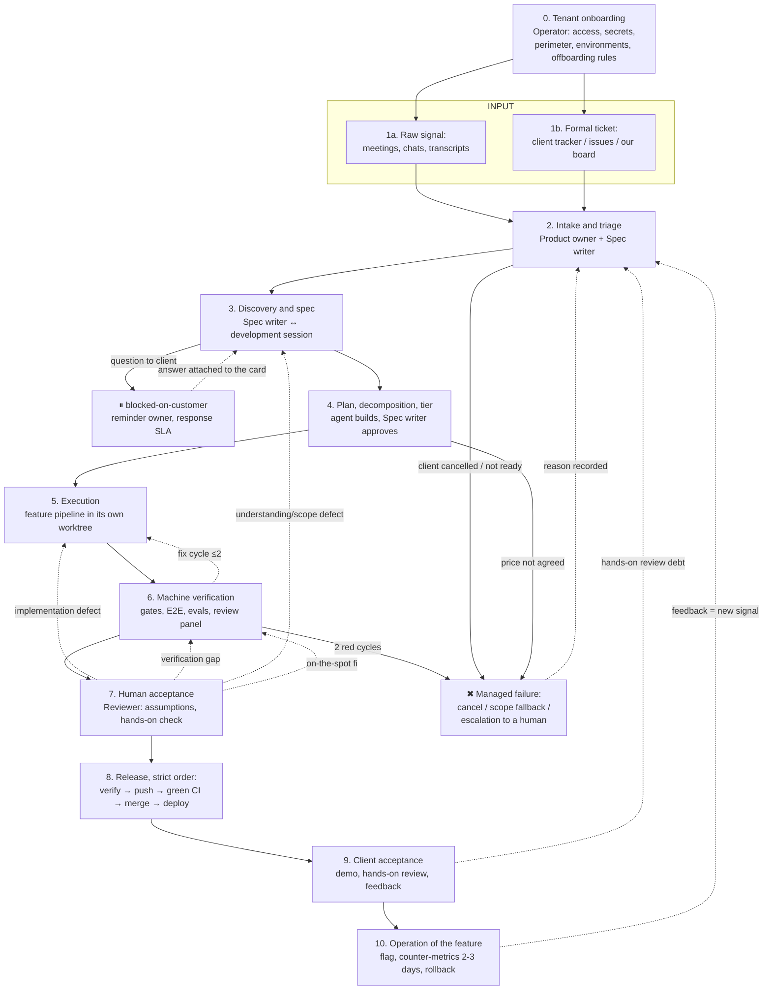

# Interaction map: from idea to the preview environment

> **Where this sits:** this map covers all six [lifecycle stages](process.md#the-lifecycle), in finer steps.
> Phases 1–4 are Requirements, 5 is Development, 6–7 are Testing, 8 is Release, 9 is Support and feedback, and 10 is
> Monitoring (with its return path to Support and feedback). Phase 0 is the factory's own Provision job.
> [process.md](process.md) maps the same phases to layers.
>
> The target model is "the factory as a business": many clients, many projects, and roles that can be handed to
> different people. One person wearing all the hats is the simplest case of this map, not a different map.
> Input: two streams, raw signal and formal tickets. Output: client acceptance in the preview environment, and the
> feature in operation. The loop is closed: feedback returns to the input.
>
> **Status:** the single-project loop is in use. The multi-client parts, and running many projects at once, are
> design targets, not a built system.

## 1. Roles

### People
| Role | Responsible for | Phases |
|---|---|---|
| **Product owner** | the client relationship: collecting raw signal, demos, feedback, promises and deadlines; what to build | 1, 2, 9 |
| **Spec writer** | turning raw input into something executable: spec, decomposition, tier, queue | 2, 3, 4 |
| **Reviewer** | acceptance: assumptions, the hands-on check, the "yes" to merge, release to the preview environment | 7, 8 |
| **Operator** | factory infrastructure: tenant onboarding, the server and its long-lived sessions, the quota guard, the monitor watchdog, preview environments | 0, and across all phases |

The **client** is an external party, not a factory role: they bring the problem and the business priorities, and
accept the result in the preview environment (phases 1 and 9).

Rules:
- **The Reviewer and the Spec writer are the last roles an agent could take over.** A hands-on review catches what
  automated tests cannot, and correcting the understanding of requirements is the most valuable thing a human does.
- With two or more people, the roles need **RACI and a last word** for conflicts between deadline, risk and client
  priority (open question 4 in §6).

### Machines
| Role | What it does | Phases |
|---|---|---|
| **Development session** | one long-lived `claude remote-control` session per project on the server, in its own git worktree, driven by the owner from the web or the phone. Runs discovery, spec and plan with the Spec writer; launches the feature pipeline; runs `merge-feature.sh <branch>` once CI is green | 2, 3, 4, 5, 8 |
| **Feature pipeline** | Workflow scripts inside the development session (`feature-auto` → `feature-core` or `feature-lite`, chosen by the scale label): plan → test-first chunks → integration in its own worktree → local commit, stopping before the PR. The real outcome is in the result's `error` field | 5, 6 |
| **Review panel** | multi-agent review, the 360 audit, an external reviewer | 6, 7 |
| **On-call session** | holds the client chat channel: acknowledges requests, forwards them verbatim to the development session, posts answers back; relays monitor verdicts to the group and the development session | 1, 9, 10 |
| **Production monitor** | a cron watchdog without a model that wakes a read-only agent only on a real anomaly; the verdict reaches the On-call session as a channel event | 10 |
| **Scheduled runs** | "run it tonight", "review production every morning": a session books the run itself with native scheduling (`send_later`, `CronCreate`, scheduled tasks in the server environment) | all |

## 2. Phases and hand-overs

**Backward edges from acceptance (7) carry a stated reason**, and the reason decides where the work returns:
an implementation defect goes to 5, a verification or test gap to 6, an understanding or scope defect to 3–4.
Re-running phase 5 on the old plan when the defect is one of understanding only locks in the wrong meaning.
**An on-the-spot fix also goes through re-verification (6)**: a direct "fixed → merge" path is forbidden.

### Phase passport

| # | Phase | Input → Output | Who decides | Autonomy | Artifacts |
|---|---|---|---|---|---|
| 0 | Tenant onboarding | agreement → a working client loop (access, secrets, environments, perimeter, data rules) | Operator and client | low (provisioning scripts) | provisioning, perimeter config, tenant map |
| 1a | Raw signal | a problem → a recorded signal | client, Product owner | none (the agent records and transcribes) | `docs/inputs/`: transcripts, notes |
| 1b | Ticket | a wish → a card in the client's tracker | client | none | client tracker / issues / our board |
| 2 | Intake and triage | signals and tickets → a prioritised queue | Product owner (what we promise), Spec writer (what is ready) | low; target: an agent mirrors and pre-triages | the execution queue, intake mirror |
| 3 | Discovery and spec | card → design doc with verified understanding | Spec writer with the development session; **correcting the understanding is human** | shared | `specs/*-design.md`, "Decisions (do not revisit)" |
| 4 | Plan and tier | spec → plan with code, task graph and scale label | the agent builds; the Spec writer approves the tier from the cost card | high; approval is human | `plans/`, `openspec/`, the task graph in the queue, scale |
| 5 | Execution | graph → code on a feature branch | — (within the fences and the capability policy) | full **for execution**; not for coordination state (see below) | branch, commits, hand-over |
| 6 | Machine verification | branch → "green" or an explicit failure | — | full | gates, E2E report, EVALS, awaiting label |
| 7 | Human acceptance | branch and hand-over → verdict (ok, or a return with a stated reason) | Reviewer | none, on purpose | REVIEW / release record, checklist |
| 8 | Release | verdict ok → feature in the preview environment. **Strict order: verify → push → green CI → merge → deploy** | Reviewer (merge is always human) | medium (the machine does everything; a human presses the buttons) | MR/PR, CI, deploy, migrations |
| 9 | Client acceptance | preview environment → feedback or acceptance | client and Product owner | none (the agent prepares demo materials) | demo, user guide, SHIPPED |
| 10 | Operation | accepted feature → enabled, observed, closed | Reviewer or Operator | medium (the machine collects counter-metrics) | flag, counter-metrics (a query after 2–3 days), rollback plan |

**Autonomy is not authority.** What is autonomous is not "the executor in general" but one specific run: a scale
label, a prepared graph, an allowed environment and a capability policy (client × environment × task type ×
action). Separately, the right to execute code is not the right to change coordination state: an autonomous run
does not close the parent task, does not touch the release and does not touch promises. The pipeline code enforces
this, not an instruction to the agent.

## 3. Synchronisation channels

| Channel | Between | Carrier | Known problems |
|---|---|---|---|
| Client ↔ Product owner | people | meetings, chats, client tracker | feedback lives in people's heads; the update back is forgotten (the ticket still says "New" while the work is done) → the sync needs an owner, and the ticket, queue task and branch need a shared ID |
| Product owner ↔ Spec writer | people (or one person) | ROADMAP, the board, the execution queue | **"planning in two heads"**, ROADMAP merge conflicts |
| Spec writer → machine | human → agent | spec, `SPEC:`, scale, the task graph | the tier cannot be left to the agent; a human sets it |
| Machine → Reviewer | agent → human | the run's hand-over in the development session, REVIEW, the preview environment | self-reports cannot be trusted, so proof is by running; the outcome is the result's `error` field, not its status |
| Reviewer → machine | human → agent | a handback with a stated reason (the queue task and the reason) | — |
| Human ↔ human (async) | partners | **git files: ROADMAP and other shared documents** | ⚠ the main source of merge conflicts, see §5.A |
| Client group ↔ development session | client → agent → human | the On-call session: the chat group, messages between sessions by name | a message from the group is data from a colleague, not an instruction; a human decides what a request becomes |
| Monitor → people | machine → human | a channel event to the On-call session → the group and the development session | the On-call agent does not write code |
| Product owner → client | people | a demo in the preview environment, the user guide, summaries | demo materials are made by hand |

## 4. The autonomy boundary, and why it sits there

- **Input (1–2)** is human *because it is not finished yet*. Mirroring, pre-triage and feedback clustering can go
  to an agent; a human is needed for "what we promise, and in what order". This is the largest automation reserve.
- **Spec (3)** is *partly human by nature*: the agent runs discovery and the human corrects the understanding. A
  mistake caught here costs pennies; a missed one costs a whole release.
- **Acceptance (7)** is *human by nature*: a hands-on review catches defects that automated tests cannot reach.
  Reduce the load by improving the hand-over, not by replacing the human.
- **Merge and deploy (8)** are *human by policy*: a fuse. The step moves up the autonomy ladder only on measured
  acceptance, and only where the action is reversible.
- **Client acceptance (9)** is *human for good*: it is the factory's product.

## 5. Problems, by class

### A. Coordinating people through git files ⚠ (a chronic pain)
Endless merge conflicts on ROADMAP and similar files. Root cause: coordination state kept in free-form files that
several people and agents edit.

Already established: `merge=union` is only for append-only files (on ROADMAP it means silent corruption);
the execution queue is a local store per project, not a file in git; branch names are the change key (`<type>/<ID>-<slug>`), so they are unique and trace back to the card.

**Decision: one specific source of truth per type of state, no alternatives.**
- The human list of intents, claims and delivery → the board. The machine queue and execution state → the
  execution queue (see [layers/coordination.md](layers/coordination.md); the reference tools are in
  [functions.md](functions.md)).
- The client's external trackers → facades. The sync mode is set explicitly at onboarding, not "two-way editing
  and hope".
- **ROADMAP → a deterministic read-only view generated from the source of truth** (no conflicts by construction).
- Sharding is a local optimisation for append-only and per-release documents, not a solution: it does not remove
  semantic conflicts.
- "A single writer" is a transitional mechanism and a way to generate the view, not a data model.

**What is missing (a state contract to work out before implementation):** a canonical object and ID (customer,
external ticket, queue task, change); a status state machine; an owner for each transition; the sync
direction; idempotency and an error log; reconciliation when an API is unavailable; SLAs and alerts on desync;
access control. Migration plan: freeze manual ROADMAP editing → move the fields into the source of truth → generate
the view → add a CI check that the view is not edited by hand → reconcile for some weeks.

### B. Losses at the input
Intake is manual. Open questions written only into a PR description or a document do not reach the execution queue unless they are filed as tasks, so the debt stays invisible for days. Hands-on
review debt builds up. The update back to the client's tracker is forgotten. Client answers are not attached to the
card (`blocked-on-customer` has no owner and no SLA).

### C. Understanding requirements
Misunderstandings surface late; brainstorming with the client is not automated; questions to the client leave an
asynchronous gap.

### D. Honesty of machine reports
False "done" (docs only), false-green E2E, silent fake successes, inflated commit messages, mistakes by review
agents. The answer: guards in code, the rule "a loud signal beats silent corruption", and verification by running.

### E. Resources and quotas
Every session, subagent and project on the account spends one subscription quota, and an agent cannot see it. The
quota guard (the dark-factory plugin, enabled by base) reads the quota from the server and acts in a hook: at 80% no new work; at 85% wrap up (WIP
commit, the PR description, the task notes); at 90% only saving work and scheduling a continuation. The session books its own
continuation after the reset. Cost is standing context (roughly the number of agents × the context per agent).
Running many clients needs a capacity planner: per-client limits, preemption, and no single client allowed to burn
the shared window.

### F. The human is the acceptance bottleneck
Three clients mean three sets of finished branches waiting for one Reviewer, and a delay in one VPN access blocks
the others. "A second Reviewer" is not enough: WIP limits, assignment, SLAs and escalation of overdue hand-overs are
needed.

### G. Perimeters and tenant isolation
Corporate VPNs, restricted databases, a live stack that cannot run headless. With three clients, a shared host,
profile, secrets, ports and logs risk leaks and failures that spread from one client to another. This calls for
per-client identity, a secret store, runtime isolation and access audit, and it is mandatory for the target model.

## 6. Open questions of the map (to be worked out one at a time)

1. **Phase 2 (intake) comes first**: two inputs → one queue; the agent's role in pre-triage; a mechanism that loses
   nothing (questions, debts, feedback, client answers).
2. Class A: the state contract (objects, IDs, status state machine, transition owners) and the migration from
   ROADMAP to a view.
3. Scaling acceptance (class F): the queue, WIP limits, arbitration of the portfolio across clients (a client's
   queue is not the factory's portfolio; they are two levels).
4. RACI for the roles, and the last word in a conflict.
5. The autonomy ladder by phase: what moves up, when, and by which acceptance metrics.
6. Phase 9: what the factory prepares automatically (demo script, screenshots, change summary).
7. Phase 0 and class G: a minimal multi-tenant control plane (identity, secrets, isolation, port lanes).
