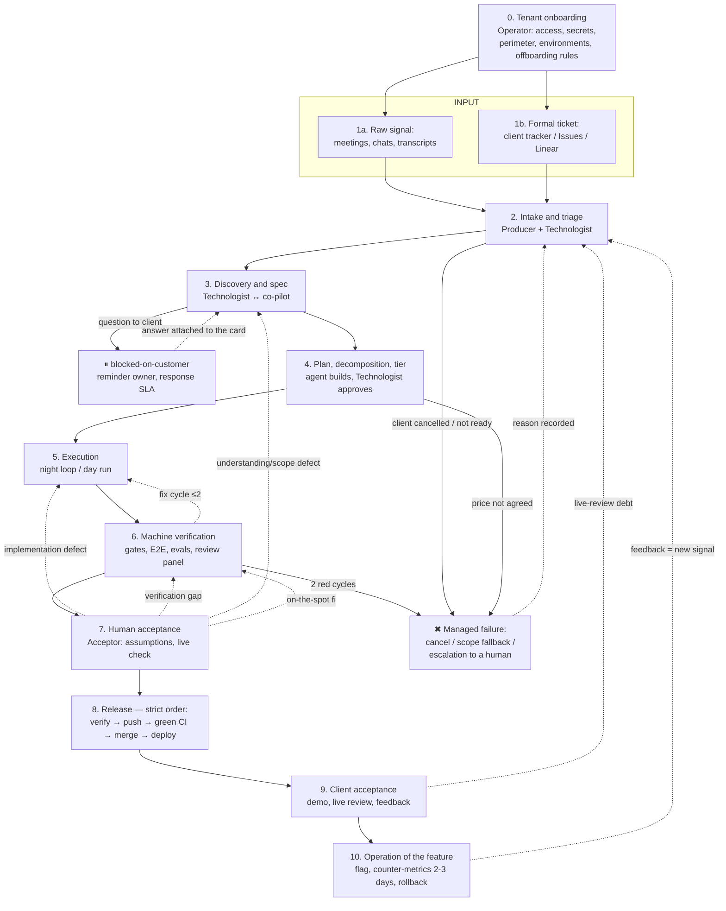

# Interaction map: from idea to stand (v0.1)

> Target model "the factory as a business": multi-client, multi-project, roles can be handed to different people
> (one person wearing all the hats is a degenerate case of the map, not a different map).
> Input: two streams (raw signal + formal tickets). Output: client acceptance on the dev stand + operation of the feature.
> The loop is closed: feedback returns to the input.
>
> **Honest status:** the map describes a proven N=1 loop plus target elements of multi-client operation.
> Multi-project operation is a target, not a built system.

## 1. Roles

### People
| Role | Responsible for | Phases |
|---|---|---|
| **Client** | pain, business priorities, acceptance on the stand | 1, 9 |
| **Producer** | relations with the client: collecting raw signal, demos, feedback, promises and deadlines | 1, 2, 9 |
| **Technologist** | turning raw input into something executable: spec, decomposition, tier, queue | 2, 3, 4 |
| **Acceptor** | the morning ritual: assumptions, live check, merge, release to the stand | 7, 8 |
| **Operator** | factory infrastructure: tenant onboarding, provisioning, nights, quotas, watchdog, stands | 0 + cross-cutting |

Rules:
- **The Acceptor and the Technologist are the last ones that can be replaced by an agent** (a live review catches what automated tests cannot; correcting the understanding of requirements is the most valuable thing a human does).
- With 2+ people, roles need **RACI and a last word** for conflicts "deadline vs risk vs client priority" (open question §6.4).

### Machines
| Role | What it does | Phases |
|---|---|---|
| **Day co-pilot** | conversational work with the Technologist/Producer: discovery, spec, plan | 2, 3, 4 |
| **Night loop** | autonomous execution of the prepared queue (tiers lite/core/auto) | 5, 6 |
| **Review panel** | multi-agent review, 360 audit, external reviewer | 6, 7 |
| **Autofix loop** | e2e-autofix: nightly failure → triage → issue → PR | 6 |

## 2. Phases and hand-overs

**Typed backward edges from acceptance (7)** — where to return depends on the defect type:
implementation defect → 5; verification/test gap → 6; understanding or scope defect → 3–4.
Running phase 5 on the old plan when the defect is one of understanding cements the wrong meaning.
**An on-the-spot fix also goes through re-verification (6)** — a direct "fixed → merge" path is forbidden.

### Phase passport

| # | Phase | Input → Output | Who decides | Autonomy | Artifacts |
|---|---|---|---|---|---|
| 0 | Tenant onboarding | agreement → a working client loop (access, secrets, environments, perimeter, data rules) | Operator + Client | low (provisioning scripts) | provisioning, perimeter config, tenant map |
| 1a | Raw signal | pain → recorded signal | Client, Producer | 0 (recording/transcript — agent) | docs/inputs/: transcripts, notes |
| 1b | Ticket | wish → a card in the client's tracker | Client | 0 | client tracker / Issues / Linear |
| 2 | Intake and triage | signals + tickets → prioritised queue | Producer (what we promise), Technologist (what is ready) | low → target: mirroring and pre-triage by an agent | bd, intake mirror |
| 3 | Discovery and spec | card → design doc with verified understanding | Technologist ↔ co-pilot; **correcting the understanding is human** | joint | specs/*-design.md, "Decisions (do not revisit)" |
| 4 | Plan and tier | spec → plan with code + graph + scale label | the agent builds; the Technologist approves the tier from the cost card | high, approval is human | plans/, openspec/, bd graph, scale |
| 5 | Execution | graph → code on a feature branch | — (within fences and capability policy) | full **for execution**; not for coordination state (see below) | branch, commits, handoff |
| 6 | Machine verification | branch → "green" or an honest fail | — | full | gates, E2E report, EVALS, awaiting label |
| 7 | Human acceptance | branch + handoff → verdict (ok / typed return) | Acceptor | 0 — on purpose | REVIEW / release record, checklist |
| 8 | Release | verdict ok → feature on the dev stand. **Strict order: verify → push → green CI → merge → deploy** | Acceptor (merge is always human) | medium (the machine does everything, the buttons are human) | MR/PR, CI, deploy, migrations |
| 9 | Client acceptance | stand → feedback/acceptance | Client + Producer | 0 (the agent prepares demo materials) | demo, user guide, SHIPPED |
| 10 | Operation | accepted feature → enabled, observed, closed | Acceptor/Operator | medium (collecting counter-metrics — machine) | flag, counter-metrics (a query after 2–3 days), rollback plan |

**Autonomy ≠ authority.** What is autonomous is not "the executor in general" but a specific run: a scale label + a prepared graph + an allowed environment + a capability policy "client × environment × task type × action". And separately: the right to execute code ≠ the right to change coordination state (the night does not close tasks, does not move the train, does not touch promises — enforced in orchestrator code, because agents repeatedly break such instructions).

## 3. Synchronisation channels

| Channel | Between | Carrier | Known problems |
|---|---|---|---|
| Client ↔ Producer | people | meetings, chats, client tracker | feedback lives in heads; the backward update is forgotten (ticket still "New" while the work is done) → an owner of the sync event and an ID link ticket↔bd↔branch are needed |
| Producer ↔ Technologist | people (or one head) | ROADMAP, Linear, bd | **"planning in two heads"**, ROADMAP merge conflicts |
| Technologist → machine | human → agent | spec + `SPEC:` + scale + bd graph | a dispatcher that splits the graph; the tier cannot be trusted to the agent |
| Machine → Acceptor | agent → human | handoff in bd, REVIEW, review surface | self-reports cannot be trusted — proof by running |
| Acceptor → machine | human → agent | typed handback (bd + reason) | — |
| Human ↔ human (async) | partners | **git files: ROADMAP, devlog, issues.jsonl** | ⚠ the main source of merge conflicts, see §5.A |
| Producer → Client | people | demo on the stand, user guide, summaries | demo materials are manual |

## 4. The autonomy boundary (and why exactly there)

- **Input (1–2)** — human *because it is unfinished*: mirroring, pre-triage and feedback clustering can go to an agent; a human is needed for "what we promise and in what order". The largest automation reserve.
- **Spec (3)** — human *in essence, partially*: the agent runs discovery, the human corrects the understanding (an error here costs pennies; a missed one costs a whole release).
- **Acceptance (7)** — human *in essence*: a live review catches a class of defects unreachable for automated tests. Reduce the load through the quality of the handoff, not by replacing the human.
- **Merge/deploy (8)** — human *by policy*: a fuse; the step is raised along the autonomy ladder by measured acceptance, only with reversibility.
- **Client acceptance (9)** — human *forever*: it is the factory's product.

## 5. Problems (register by class)

### A. Coordinating people through git files ⚠ (chronic pain)
Endless merge conflicts on ROADMAP and similar files. Root cause: coordination state in free-form files edited by several heads + agents.

Already established: `merge=union` is only for append-only files (on ROADMAP it means silent corruption); issues.jsonl is a snapshot, merged through the store; CURRENT_TRAIN is incremented only by a human.

**Decision: one concrete source of truth per type of state, no alternatives.**
- internal queue and statuses → beads;
- the client's external trackers → facades (the sync mode is defined explicitly at onboarding, not "two-way editing on hope");
- **ROADMAP → a deterministic read-only view generated from the source of truth** (no conflicts by construction);
- sharding is a local optimisation for append-only and per-release documents, not a solution (it does not remove semantic conflicts);
- "a single writer" is a transitional mechanism and a way to generate the view, not a data model.

**What is missing (state contract — work it out before implementation):** a canonical object and ID (customer / external ticket / bd / train / change); a status state machine; an owner for each transition; sync direction; idempotency and an error log; reconciliation when an API is unavailable; SLA/alerts on desync; ACL. Migration plan: freeze manual ROADMAP editing → move the fields into the source of truth → generate the view → a CI check "the view is not edited by hand" → weeks of reconciliation.

### B. Losses at the input
Intake is manual; devlog questions do not reach bd (debt stays invisible for days); live-review debt; the backward update to the client's tracker is forgotten; client answers are not attached to the card (`blocked-on-customer` without an owner or SLA).

### C. Understanding requirements
Understanding errors surface late; brainstorming with the client is not automated; questions to the client are an asynchronous gap.

### D. Honesty of machine reports
False done (docs-only), false-green E2E, silent fake successes, inflated commit messages, mistakes of review agents. Answer: guards in code + "a loud signal beats silent corruption" + verification by running.

### E. Resources and quotas
Runaway loops burn the 5-hour window; the quota cannot be measured from inside; the watchdog needs calibration; cost = standing context (≈ number of agents × context per agent). Multi-client operation needs a capacity planner: per-client limits, preemption, no single client allowed to burn the whole night.

### F. The human is the acceptance bottleneck
Three clients → three night results in one Acceptor's morning; a delay in one VPN access blocks the others. "A second Acceptor" is not enough: WIP limits, assignment, SLA and escalation of overdue handoffs are needed.

### G. Perimeters and tenant isolation
Corporate VPNs, restricted databases, a live stack unavailable headless. With 3 clients: a shared host/profile/secrets/ports/logs = risk of leaks and mutual failures → per-client identity, a secret store, runtime isolation, access audit. Mandatory for the target model.

## 6. Open questions of the map (to be worked out piece by piece)

1. **Phase 2 (intake) — first in line**: two inputs → one queue; the agent's role in pre-triage; the "nothing gets lost" mechanism (questions, debts, feedback, client answers).
2. Class A: the state contract (objects, IDs, status state machine, transition owners) + migration ROADMAP → view.
3. Scaling acceptance (class F): queue, WIP limits, portfolio arbitration between clients (a client's queue ≠ the factory's portfolio — two levels).
4. RACI of roles and the last word in a conflict.
5. The autonomy ladder by phase: what is raised and when, by which acceptance metrics.
6. Phase 9: what the factory prepares automatically (demo script, screenshots, change summary).
7. Phase 0/G: a minimal multi-tenant control plane (identity, secrets, isolation, port lanes).
