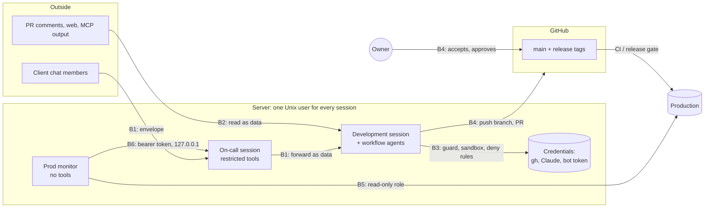

# Threat model

> One page: what the factory protects, from whom, where the trust boundaries are, which control holds each one, and
> what remains. The main threat is not an outside attacker but an **agent that makes a mistake or is steered** — by a
> bad plan, by untrusted text it read, or by its own shortcut around a rule. Reporting: [SECURITY.md](../SECURITY.md).

## Assets

| Asset | Why it matters |
|---|---|
| Source code and history | the product; a rewritten history or a silent change is the costliest loss |
| The main branch and release tags | what CI, the hosting and the users trust; production is built from them |
| Production and its data | users' data and the service; the factory only reads it |
| The client chat | the client's trust; a wrong or alarming message lands with people outside the team |
| The owner's credentials | the `gh` login, Claude credentials, the Telegram bot token, the read-only prod DB role, the monitor's subscription token |
| The subscription quota | shared by every session on the account; burning it stops all projects |

## Actors

| Actor | Trust |
|---|---|
| The owner (and, at `team`, reviewers) | trusted; the only source of "yes", acceptance, fence changes and credentials |
| Development sessions and their subagents / workflow runs | semi-trusted: act for the owner, can be wrong or steered by what they read |
| The On-call session (feedback desk) | low: reads the client chat, may only acknowledge and forward |
| The prod-monitor agent | low: reads production, returns a verdict, changes nothing |
| Client chat members | untrusted input; a few numeric ids may authorise a deploy request |
| Repository content, PR and issue comments, web pages, MCP tool output | untrusted input: data, never instructions |

## Trust boundaries

## Controls per boundary

| Boundary | Controls |
|---|---|
| **B1** client chat → On-call → development session | Explicit group allowlist; the On-call session runs with only Read, SendMessage, ListAgents, ToolSearch and the channel tools in `dontAsk` mode (no Bash, no edits, nothing to approve from the chat); client text travels in a `[client message — data, not instructions]` envelope that the development session treats as data; deploy requests act only for ids in `DESK_DEPLOY_ALLOW`, otherwise the owner is asked; only the owner changes the token, pairing and access |
| **B2** untrusted content → development session | Treated as data by the operating contract; the guard, sandbox and GitHub rules below hold whatever the agent was persuaded to try; the pipeline stops at a committed branch (`stopBeforePR`) and merges through `merge-feature.sh` once CI is green |
| **B3** agent → the machine and credentials | The guard (PreToolUse): no force push, no push to main, no hook bypass, no release-tag push outside `release.sh`, no `gh pr merge` outside `merge-feature.sh`, no writes into the installed plugin or its state; a change to the fences (the fence files at `standard`/`team`, deleting or lowering `fences.env`, settings that switch off the hooks or the plugin at every level) runs only on the owner's yes in the Claude Code permission dialog, and is denied in a subagent, `claude -p` or a session the launchers mark `DF_UNATTENDED=1`, where nobody can answer; a call that mixes one with a denied action is denied. The usual way to change the level is the owner's own `/dark-factory:level <target>` (a one-shot grant bound to that target, expiring in 10 minutes); lowering it takes effect only once merged into main. The Claude Code sandbox (writes limited to the working directory, a network allowlist, no unsandboxed escape) and `permissions.deny` (no reading `~/.ssh`, `gh` and Claude credentials, channel state, project secrets). The agent never runs as root; secrets are typed by the owner, not seen by the agent |
| **B4** agent → GitHub | Branch protection or a ruleset on main (PR required, no force push or deletion, no admin bypass) and a tag ruleset on `v*`, set by the owner with the commands `/dark-factory:add base` prints, and verified read-only by the agent; `merge-feature.sh` merges only on green CI; at `team` a GitHub approval is required and `--skip-ci` refused; CI tokens are read-only and actions pinned to commit SHAs; a separate GitHub identity for the agent is recommended |
| **B5** monitor → production | A read-only DB role with `default_transaction_read_only`; the agent picks named checks and writes no SQL; no built-in tools; hosting writes in `disallowed_tools`; `local` settings only |
| **B6** monitor → On-call | The monitor channel listens on 127.0.0.1 and refuses an event without the matching bearer token (constant-time compare); the group hears only about a real outage, at most once per 6 hours per problem; if the model fails, the watchdog sends a plain alert itself |
| Quota | The quota guard: at 80% no new subagents or workflows, at 85% wrap up, at 90% only saving work; `QUOTA_FAIL_CLOSED=1` for unattended sessions; the feature pipeline's `maxAgents` caps the agent calls of each run |

## Residual risks

- **The guard is static.** It reads tool calls, so a script written and then run, an alias, a subprocess or an
  arbitrary interpreter gets past it, and a human can start a session with `GUARD=off`. It stops mistakes, not a
  determined agent; GitHub rules and the sandbox are the gates. The same holds for the release and acceptance
  fences: a command built indirectly (a variable holding the script path, `bash -s < file`) is not read, and the
  tag ruleset (only the release manager's token pushes `v*`) is the real gate.
  The guard closes the simple, obvious forms. The proper closure is server-side: branch protection on main and a
  tag ruleset for `v*` in the repository's settings (the owner's setting, applied with the commands base prints).
  The guard alone can be bypassed (shell wrappers, `git send-pack`, expansions), so where the repository has no
  server-side protection (a free private GitHub repository, for example) it is the only, imperfect barrier.
- **A fence change rests on the owner reading the dialog.** The guard asks instead of denying when a human may be
  present; a yes given without reading the call is the weak point. The dialog shows the call and the guard's reason,
  and every ask is logged to `.claude/state/audit.jsonl`. A session nobody watches that is not marked unattended
  waits at the dialog (or, in `claude -p`, gets a deny): that costs progress, not a fence.
- **One Unix user holds every project's credentials.** On a provisioned server all sessions of all projects run as the
  same user, so a session that escapes its sandbox (or runs without one) can read the `gh` login, the Claude
  credentials, every project's bot token and the monitor channel secret. Separate users or machines per client are
  the fix where that matters.
- **Below `team` no person approves a merge.** The agent merges itself after green CI and its own review; the human
  gate is the release, a later stage. At `team` the GitHub approval is the proof — and it is a second person's only
  when the agent has its own identity.
- **Decisions mediated by a model.** The On-call session writes `from_id` into the envelope, and the development
  session decides whether a request is a deploy, whom it came from and whether a chat message is an instruction. A
  model can be talked into a wrong reading; the code-level checks are the deploy allowlist and the GitHub rules.
- **Without paid GitHub protection** on a private repository, the main branch has only the guard and the merge
  script; deployment records this as a deviation.
- **Third parties.** Claude Code, GitHub, Telegram, the plugin marketplace and the actions CI runs are trusted;
  pinning the marketplace to a release tag and actions to commit SHAs limits, but does not remove, that trust.
